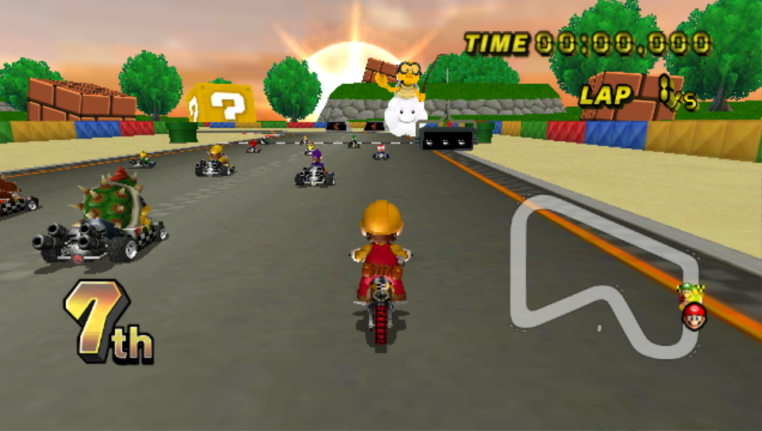
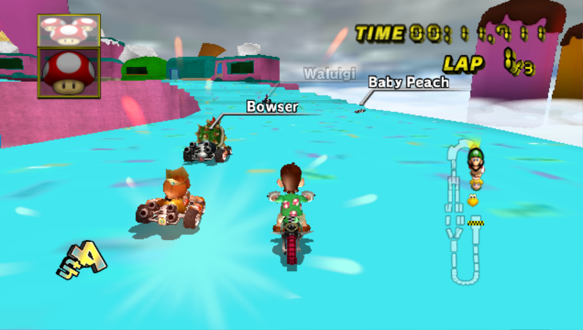
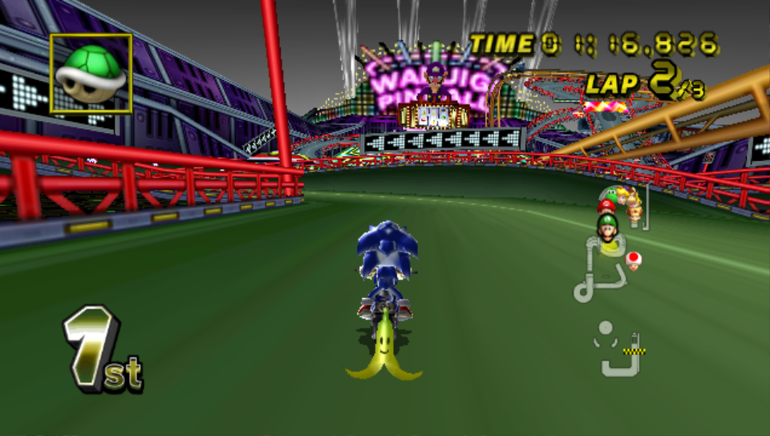

# Mario Kart Wii for PS Vita

A native PlayStation Vita port of
[MiniBandit's MKW-3DS](https://github.com/MiniBandit/MKW-3DS), a 1:1
recreation of **Mario Kart Wii** for the Nintendo 3DS. It's a port of that
3DS recreation, not of the Wii game: no Wii code runs.

It isn't an emulator. The game runs natively on the Vita:
- **Physics:** kart physics come from [Kinoko](https://github.com/vabold/Kinoko), a recreation of Mario Kart Wii's physics.
- **Game code:** menus, races, items and the AI are MKW-3DS's native code.
- **3DS layer:** a small layer underneath that code provides the 3DS system and graphics functions it expects, implemented with the Vita's own APIs and [vitaGL](https://github.com/Rinnegatamante/vitaGL).

This repository contains **no Nintendo or Retro Rewind files**. You build the
game files yourself, on your own computer, from your own Mario Kart Wii disc.

There are **two editions**, which install side by side:

| | **Mario Kart Wii** | **MKW Retro Rewind** |
|---|---|---|
| VPK in the releases | `mkw.vpk` | `mkw-retro-rewind.vpk` |
| Built from | your disc | your disc and your own [Retro Rewind](#retro-rewind-edition) install |
| Game files on the Vita | `ux0:data/mkw` | `ux0:data/mkwrr` |
| Saves, settings and logs | `ux0:data/mkw` | `ux0:data/mkwrr` |

> **Status: playable.** Grand Prix (with Mirror and the award ceremony), VS,
> Team VS, Time Trials and Battle all run on real hardware, with sound, in
> 16:9. Make a license and unlock characters, vehicles, cups and Mirror as on
> the Wii, or unlock everything in [Settings](#settings).
>
> **Frame rate by preset:** a steady **60 FPS** in Performance, **45-60 FPS**
> in Default, and sharper graphics at a locked **30 FPS** in Quality.
>
> The first time a new material appears, the game pauses to compile its
> shader. Shaders are cached, so later launches are smooth.

## What works

The Mario Kart Wii edition (for the Retro Rewind edition, see [below](#retro-rewind-edition)):

| | |
|---|---|
| Menus, Grand Prix (50/100/150cc and Mirror), VS, Team VS, Time Trials | ✅ |
| Grand Prix award ceremony and final standings | ✅ |
| All 24 drivers and their karts and bikes | ✅ |
| Licenses: four named save slots, each with its own unlocks, best times and ghosts | ✅ |
| Unlocks as on the Wii: characters, vehicles, cups, Mirror and the karts/bikes switch | ✅ |
| Expert staff ghost unlock times (read from your disc), counting toward unlocks | ✅ |
| Settings screen from the LiveArea: presets, resolution, graphics, Unlock Everything | ✅ |
| Items, CPU racers, results and standings | ✅ |
| Music and sound effects | ✅ |
| Wii-style course map, race timer and incoming-item warning | ✅ |
| Widescreen (16:9) | ✅ |
| Battle: team Balloon Battle and Coin Runners on all ten arenas | ✅ |
| Steady 60 FPS | ✅ With the Performance preset (45-60 FPS in Default) |
| Racing or watching the staff ghosts | ⏳ In progress (their times already count) |
| Online | ❌ Not yet |

## What you need

**To play:**
- A PS Vita or PS TV with [HENkaku / Ensō](https://vita.hacks.guide) and VitaShell.
- `ur0:data/libshacccg.suprx`, the Vita's shader compiler. Extract it once with [ShaRKF00D](https://github.com/Rinnegatamante/ShaRKF00D).
- About **3 GB** free on `ux0:` for the game files.

**To build** (see [BUILDING.md](BUILDING.md)):
- **Mario Kart Wii (USA)**, game ID `RMCE01`, dumped as `.iso` or `.wbfs`. Convert RVZ or NKit dumps to ISO in Dolphin first. Other regions aren't supported yet.
- A Windows PC with about 15 GB free.
- [Python 3.11+](https://www.python.org/downloads/), [Node.js LTS](https://nodejs.org) and [Git](https://git-scm.com).
- [VitaSDK](https://vitasdk.org), only if you build the VPK yourself.

**To build on macOS or Linux** (see [BUILDING-MAC-LINUX.md](BUILDING-MAC-LINUX.md)):
- **Mario Kart Wii (USA)**, game ID `RMCE01`, dumped as `.iso` or `.wbfs`. Convert RVZ or NKit dumps to ISO in Dolphin first. Other regions aren't supported yet.
- A Mac or Linux PC with about 15 GB free.
- [Python 3.11+](https://www.python.org/downloads/), [Node.js LTS](https://nodejs.org) and [Git](https://git-scm.com).
- devkitPro's `tex3ds`. On Linux, install it with `dkp-pacman -S tex3ds`. On macOS you have to build it from source; the guide walks you through it.
- Run `python3 build-game-files.py` from the repo folder. This only builds the game files; get the VPK from the [releases](https://github.com/boomannotjeff/mkwiita/releases/latest).

## Quick start

For the Retro Rewind edition, see [its quick start](#retro-rewind-edition).

1. **Get the VPK:** download `mkw.vpk` from the [latest release](https://github.com/boomannotjeff/mkwiita/releases/latest).
2. **Build the game files** from your disc: double-click **`Build Game Files.bat`**, drag your disc image into the window and press Enter. The first build takes 30–60 minutes.
   Use the source code of the same release as your VPK (the release page has it as a zip), so the game files match the program.

   *Building the VPK yourself?* Use **`Build MKW Vita.bat`** instead: it needs VitaSDK and makes both the game files and `build\vita\mkw.vpk`.
3. Install the VPK with VitaShell.
4. Copy the **contents** of `build\vita\data\mkw\` to `ux0:data/mkw/` on the Vita, over USB or FTP in VitaShell.
5. Launch **Mario Kart Wii** from the LiveArea and pick an empty license slot to make your license: the
   Vita's keyboard asks for its name.

**Updating from 1.2.0:** build the game files again from the 1.3.0 source and copy them over (the VPK and the
game files must come from the same release). Your best times and ghosts move into the first license you
create.

**Please don't share the game files** (`data/mkw`): they contain Nintendo's
game data. The VPK itself is only the program; it holds no game data.

## Retro Rewind edition

**MKW Retro Rewind** is a separate app made from your own copy of the
Retro Rewind 6 Wii mod. It plays its tracks, music, character skins and
menus on this port's engine. The build reads them from your Retro Rewind folder; nothing from
Retro Rewind is in this repository or in the VPK.

| | |
|---|---|
| All 79 cups: 44 Retro and 35 Custom, with Retro Rewind's cup pages and coloured track names | ✅ |
| 310 of the 316 tracks, each with its own music and lap count | ✅ |
| 200cc (after 150cc, in place of 50cc) and Mirror | ✅ |
| Character skins: L/R on the character screen, with the preview (113 of Retro Rewind's 123) | ✅ |
| Speedometer (SELECT) | ✅ |
| Everything unlocked from the start, as in Retro Rewind | ✅ |
| Retro Rewind menu entries for features this port doesn't have: shown, and say "Not available" | ➖ |
| N64 Luigi Raceway, Shadow Woods, Lunar Lights, Kinoko Cave, Desert Creek, Nivurbia | ❌ "Not available" (don't convert yet) |
| Retro Rewind's own gameplay rules and item changes, its battle arenas (the ten Wii arenas are used), track variants | ❌ Not yet |
| Online | ❌ No |

**What you need**, on top of [the usual](#what-you-need):
- Retro Rewind 6 installed on your PC: the `RetroRewind6` folder, as Dolphin or WheelWizard
  installs it (for example `%APPDATA%\Dolphin Emulator\Load\Riivolution\WheelWizard\RetroRewind6`).
  Built and tested with 6.13.3.
- About **45 GB** free on the PC, and a few hours for the first build.
- About **8 GB** free on `ux0:`.

**Quick start:**
1. Download `mkw-retro-rewind.vpk` from the [latest release](https://github.com/boomannotjeff/mkwiita/releases/latest).
2. Unzip the same release's source code into its **own folder**, not the one you use for the normal edition:
   one folder builds one edition, and the build stops if you mix them.
3. Double-click **`Build Retro Rewind Game Files.bat`**, drag in your disc image, then your
   `RetroRewind6` folder (or just press Enter to use Dolphin's).

   *Building the VPK yourself?* Use **`Build MKW Retro Rewind Vita.bat`** instead (needs VitaSDK);
   it makes `build\vita\mkw.vpk`, the Retro Rewind app.
4. Install the VPK with VitaShell and copy the **contents** of `build\vita\data\mkwrr\` to
   `ux0:data/mkwrr/`. Most of it is a few large `.pak` files, so USB or FTP both work well.
5. Launch **MKW Retro Rewind** from the LiveArea.

Settings, logs and troubleshooting work as below, with `ux0:data/mkwrr` in place of `ux0:data/mkw`.

| | |
|---|---|
|  |  |

## Controls

| Vita | Action |
|---|---|
| Left stick | Steer; up/down when using an item throws forward/back |
| Cross | Accelerate / confirm |
| Circle | Look behind (hold) / back in menus |
| Square | Brake, reverse |
| R | Hop and drift; trick off a ramp |
| Triangle | Trick (stick picks the direction) / bike wheelie |
| D-pad | Trick / wheelie (Classic Controller style) |
| L | Use item |
| START | Pause |
| SELECT | Speedometer on/off |

## Progression

Each license unlocks what Mario Kart Wii unlocks, the same way (full list of conditions:
[IGN's Mario Kart Wii unlockables](https://www.ign.com/wikis/mario-kart-wii/Unlockables)):

- **Cups:** Star after trophies in Mushroom and Flower, Special after Star; Leaf after Shell and Banana,
  Lightning after Leaf (in each engine class).
- **Mirror:** win every 150cc cup. **Bikes in 50cc / karts in 100cc:** a trophy in every cup of that class.
- **Characters and vehicles:** cup wins, 1-star ranks, Time Trial courses played and expert staff ghosts
  unlocked, as listed in Mario Kart Wii's unlock table. A Time Trial at or under a course's expert unlock time
  (from your disc) unlocks its expert ghost.

New unlocks are announced when you're back in the menus. Locked choices are dimmed and say "Locked".
Don't want to unlock things? Turn on **Unlock Everything** in Settings: it opens everything for every license,
and turning it off again brings back each license's own progress.

## Settings

Tap **Settings** under Start on the game's LiveArea (close the game first). Up/down choose, left/right or
Cross change, then **Save and Start** or **Save and Exit**; Circle leaves without saving.

| Setting | |
|---|---|
| Preset | **Performance** (steady 60 FPS: shadows, bloom and extra particles off), **Default** (45-60 FPS, everything on) or **Quality** (2x resolution, every effect, locked 30 FPS). Shows **Custom** when you change something yourself |
| Resolution | Internal resolution, `1` to `2` (default `1.5`); Cross types a value. The game restarts to apply it |
| Framerate | `60` or a steady `30` |
| Shadows, Bloom, Particles | Kart and object shadows; glow (off/low/high); fewer smoke and spark particles |
| Object detail | How far objects keep their full detail |
| Minimap | The Wii-style map or the simple racing-line map |
| Unlock Everything | Every character, vehicle, cup and Mirror, for every license |
| License 1-4 | Delete a license (press Cross twice) |
| Reset to Defaults | The default graphics settings |

The graphics settings are saved in `ux0:data/mkw/quality.txt` (one `name=value` per line), which you can
still edit by hand. The values in use are written to `ux0:data/mkw/vita.log` at start-up.

## Troubleshooting

- **Black screen after the vitaGL logo:** `libshacccg.suprx` is missing (see above), or the game files aren't in `ux0:data/mkw/`.
- **Short freezes on the first launch:** shaders compiling. They're saved to `ux0:data/mkw/shaders/` and loaded at start-up after that.
- **Something looks wrong after an update:** delete `ux0:data/mkw/shaders/` to rebuild the shader cache.
- **Settings button does nothing:** close the game first (hold the LiveArea page and pull it away), then tap it.
- **Saves:** licenses and unlocks are in `ux0:data/mkw/save.bin`, ghosts in `ux0:data/mkw/ghosts/`.
- **Logs:** `ux0:data/mkw/vita.log` (graphics, frame rate) and `ux0:data/mkw/runtime.log` (game). Attach both when reporting a problem.
- **Retro Rewind edition:** the same files are in `ux0:data/mkwrr/`. A track that crashes: attach both logs and say which track it was.
- **Problems building assets:** Try to use python 3.14.5 and make sure you have Visual C++ 14.0 or later.

## How it works

The 3DS game talks to libctru (the 3DS system library) and citro3d (its GPU
library). `platform/vita` re-implements the parts it uses on the Vita:
- **System:** threads, locks, timing, input and files.
- **Graphics:** the 3DS GPU's texture combiner becomes generated GLSL shaders, its vertex shaders are ported to GLSL, and textures are converted from the 3DS tiled format.
- **Sound:** a software mixer stands in for the 3DS DSP.

Details: [docs/VITA_PORT.md](docs/VITA_PORT.md).

## Credits

- **dudewhat:** the original Mario Kart Wii recreation for the 3DS
- **MiniBandit:** [MKW-3DS](https://github.com/MiniBandit/MKW-3DS), the continuation this port is built on (including its Balloon Battle groundwork)
- [Kinoko](https://github.com/vabold/Kinoko) by vabold (MIT): Mario Kart Wii physics
- [vitaGL](https://github.com/Rinnegatamante/vitaGL) and [vitaShaRK](https://github.com/Rinnegatamante/vitaShaRK) by Rinnegatamante: OpenGL and runtime shaders on the Vita
- [VitaSDK](https://vitasdk.org): the Vita toolchain
- [citro3d](https://github.com/devkitPro/citro3d) (zlib) and [libctru](https://github.com/devkitPro/libctru) (zlib): 3DS headers, matrix maths and the texture loader
- [Azahar](https://github.com/azahar-emu/azahar): reference for the 3DS GPU's texture and combiner behaviour
- [noclip.website](https://github.com/magcius/noclip.website) (MIT) and [gclib](https://github.com/LagoLunatic/gclib) by LagoLunatic (MIT): disc and model tools
- [ogws](https://github.com/doldecomp/ogws) and [mkw](https://github.com/snailspeed3/mkw) decompilations (CC0): references
- **The Retro Rewind team:** Retro Rewind, whose tracks, music, skins and menus the Retro Rewind edition is built from (from your own install)

Mario Kart Wii is © Nintendo. This is an unofficial fan project with no
affiliation with Nintendo, Sony or the Retro Rewind team. See [NOTICE](NOTICE).
